# GRAM POS

**GRAM POS** is a configurable, local-first point-of-sale project. The portable `gram-pos-core` Rust library powers a native register prototype. The portable pricing core is dependency-free. The first use case is deli and prepacked flower; the domain is deliberately generic.

Repository: https://github.com/LJrobinson/GRAM-POS.

## Record cash added or removed (milestone 10)

Version **0.10.0** adds explicit **Paid in** and **Paid out** records for an open cash session. Enter an exact positive amount and required nonpersonal reason, review the details, then confirm. Cancel writes nothing. Each committed adjustment is an immutable record with its own identity and retry key, not a sale, refund, receipt, tax or inventory event.

Expected drawer cash is **opening float + cash sales − cash refunds + paid-ins − paid-outs**. Paid-ins/out do not change revenue. A conservative paid-out limit refuses amounts above current expected cash; it does not verify the physical drawer or provide an accounting policy. Closed sessions cannot be changed, and a stale closing review is rejected even when intervening adjustments net to zero. Lost responses can be reconciled with the same saved request after reload or restart.

The cash view separates every total and shows movement reasons and event details in the configured store timezone. Schema/backup v4 preserves the ledger and parked-cart recovery in one consistent snapshot; recovery still accepts v1/v2/v3 backups without rewriting historical receipts. See the [cash workflow and limits](docs/cash-sessions.md), [backup guide](docs/backup.md) and [validation status](VALIDATION.md).

Desktop and phone browser scenarios are included for reviewed paid-ins, recorded paid-outs and closing/history. Current milestone-10 screenshots will be added only from verified passing real-Rust CI artifacts. The earlier screenshots below retain their original milestone labels. This prototype does not move real money or activate cash-drawer hardware.

## Park a cart and return to it (milestone 9)

Version **0.9.0** adds durable local parked carts. Save a nonempty cart with an optional short, nonpersonal label, continue another sale, then preview and resume the saved quantities. The preview uses **current catalog and prices**, not a promise to hold a price. Measured grams, package counts and unit counts remain separate; unavailable products and changed product types are flagged rather than silently removed or reinterpreted.

Resume never overwrites a nonempty active cart. Park it first, or explicitly clear it. Parked-cart discard requires confirmation. Saving, parking and resuming use durable identity, revision checks and retry keys; checkout consumes the active identity in the same SQLite transaction as the receipt. Parking does not create a sale, reserve stock, record cash or add customer records. See the [parked-cart guide](docs/parked-carts.md) and [backup/recovery guide](docs/backup.md).

These unmodified desktop and phone captures come from the [passing real-Rust browser job](https://github.com/LJrobinson/GRAM-POS/actions/runs/39206584813/job/117911033610) at commit `85eb436`. All **37 browser scenarios** passed against Rust and SQLite. The Cedar Market products, labels and amounts are synthetic training fixtures, not customer data or real sales. Browser viewport checks are not physical-phone or native WebView2 certification.

<details>
<summary>Preview a parked mixed cart before resuming</summary>

The saved cart keeps **3.621 g measured**, **2 packages** and **3 units** distinct. Its current quote is $30.87. Parking and previewing create no sale, cash movement or stock reservation; Resume is a separate action.

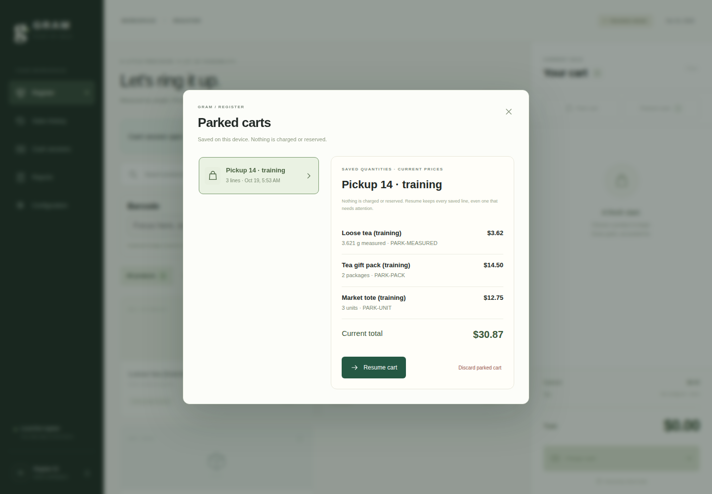

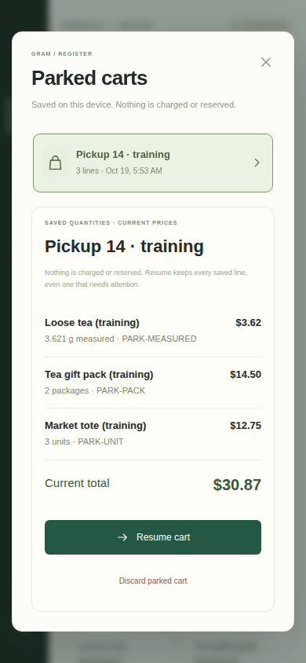

</details>

<details>
<summary>Review current prices rather than assuming an old price is held</summary>

The tote's current price and name have changed. The preview now quotes $33.12, explains the changes and requires review before Resume. Every original quantity remains unchanged.

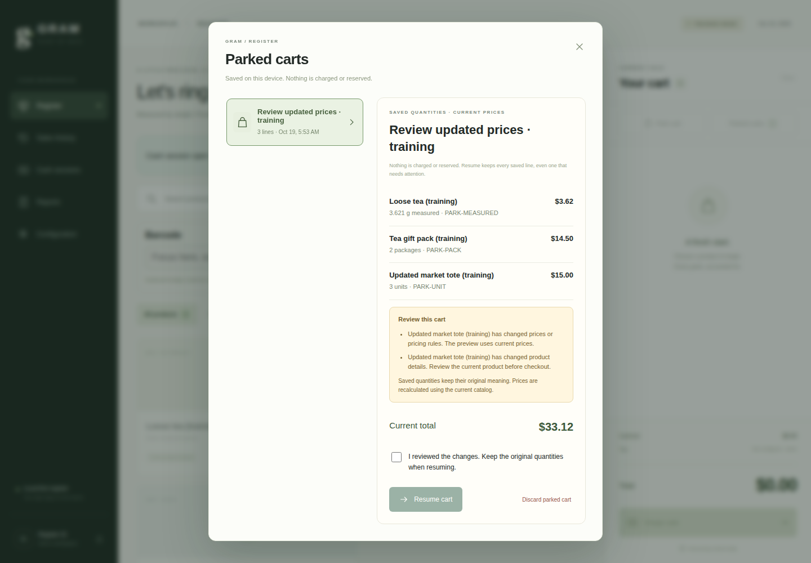

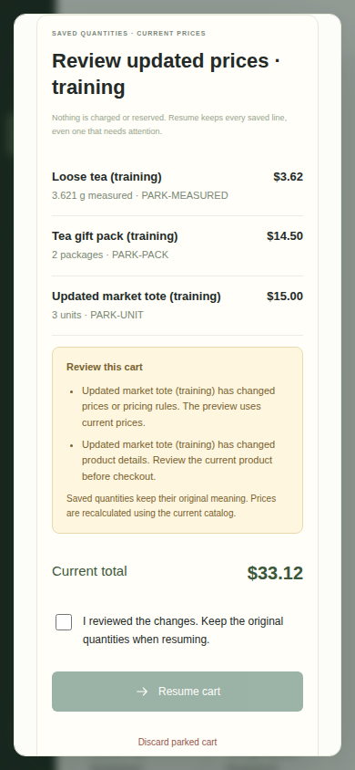

</details>

<details>
<summary>Keep missing, archived and changed-type products visible</summary>

No invalid line is silently dropped or converted. This cart has no usable total until its issues are resolved; review and resume preserve the original lines, and checkout stays blocked. The long phone warning is vertically scrollable, with review controls below the captured view.

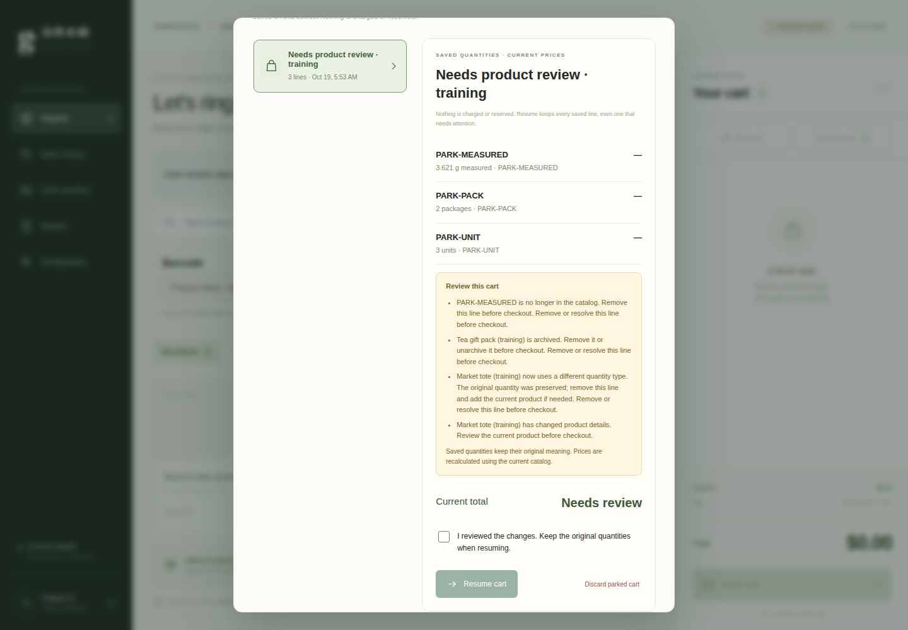

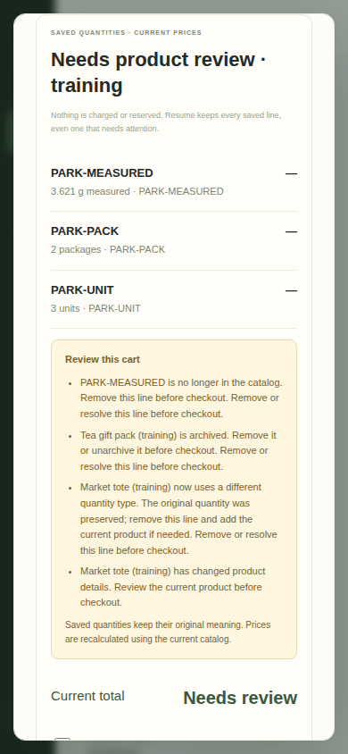

</details>

## Store identity and local business days (milestone 8)

Version **0.8.0** adds a revision-checked **Store settings** editor with an explicit receipt preview, Save and Cancel. Configure the store display name and optional plain-text header, contact and footer without changing currency or pricing. New receipts retain the saved identity; existing receipt bytes and legacy printing are unchanged. Training warnings cannot be removed.

Reports now accept an explicit IANA timezone, defaulting to UTC for compatibility. The register offers the saved store timezone, but each report can select another zone. Rust resolves inclusive/exclusive local calendar midnights using IANA rules, including 23-hour and 25-hour daylight-saving days, and returns exact UTC boundaries. CSV exports identify the zone, bounds, revision and event offsets; stale settings prevent exporting an outdated selection. See [store settings and timezone guide](docs/store-settings.md) and [receipt/report semantics](docs/receipts-and-reports.md).

These unmodified screenshots come from the [passing real-browser job](https://github.com/LJrobinson/GRAM-POS/actions/runs/39194908384/job/117875732987) at commit `08bbd98`, using the actual Rust service and SQLite. They show training fixtures, not real business data, production certification or physical-device testing.

<details>
<summary>Preview store identity before saving</summary>

The display name, optional plain-text receipt fields and default report timezone are reviewed before Save. The preview keeps its mandatory training warning; viewing or canceling it does not write settings.

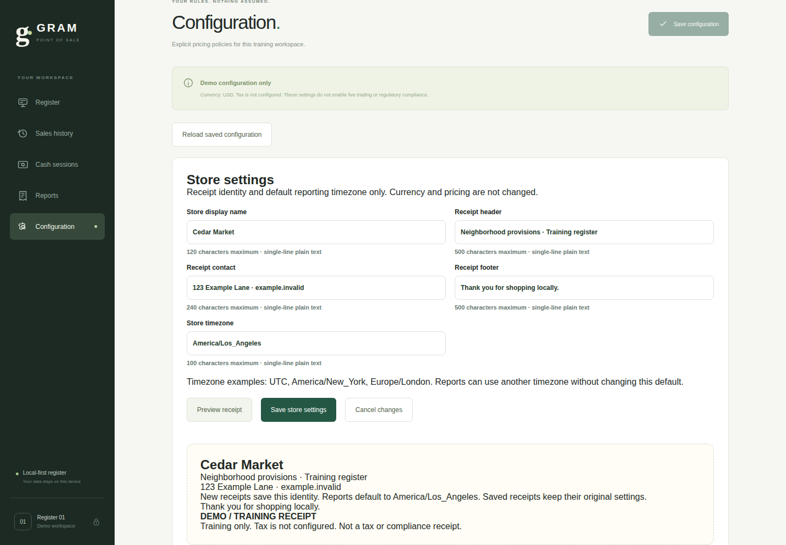

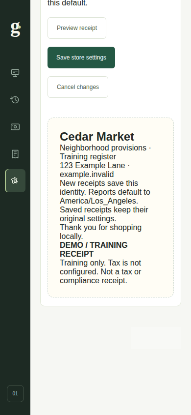

</details>

<details>
<summary>Reprint the identity saved with the original sale</summary>

The original Cedar Market receipt still shows its saved header, contact, footer and Los Angeles offset after current settings were changed to another name and timezone. The browser test also refunds the sale and verifies that its original printable markup remains identical.

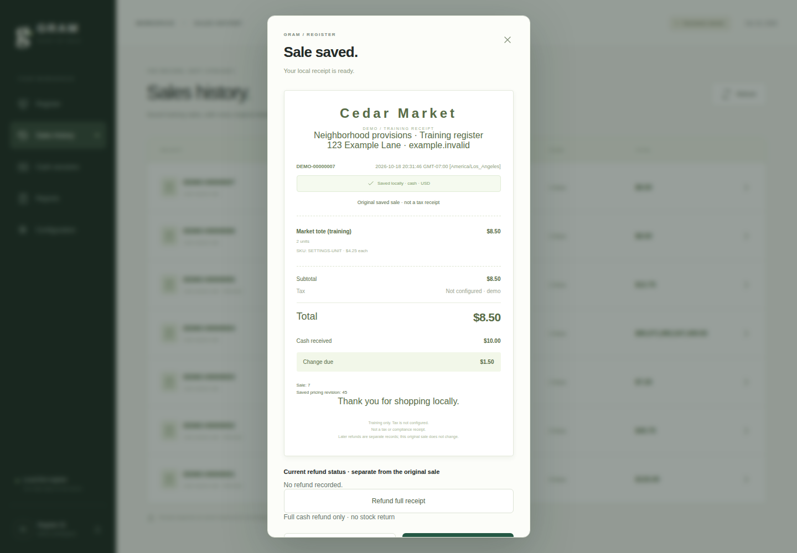

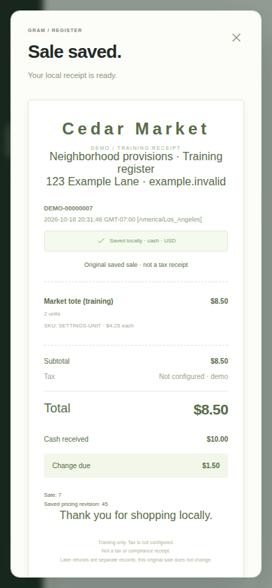

</details>

<details>
<summary>Report local business days with resolved UTC boundaries</summary>

The report identifies `America/Los_Angeles`, inclusive/exclusive local dates, resolved UTC bounds and per-event offsets. The deliberately enormous totals exercise exact-integer arithmetic across the shared training fixtures; they are not real revenue. The phone capture shows the timezone/date controls; summary and activity remain below the fold by vertical scrolling.

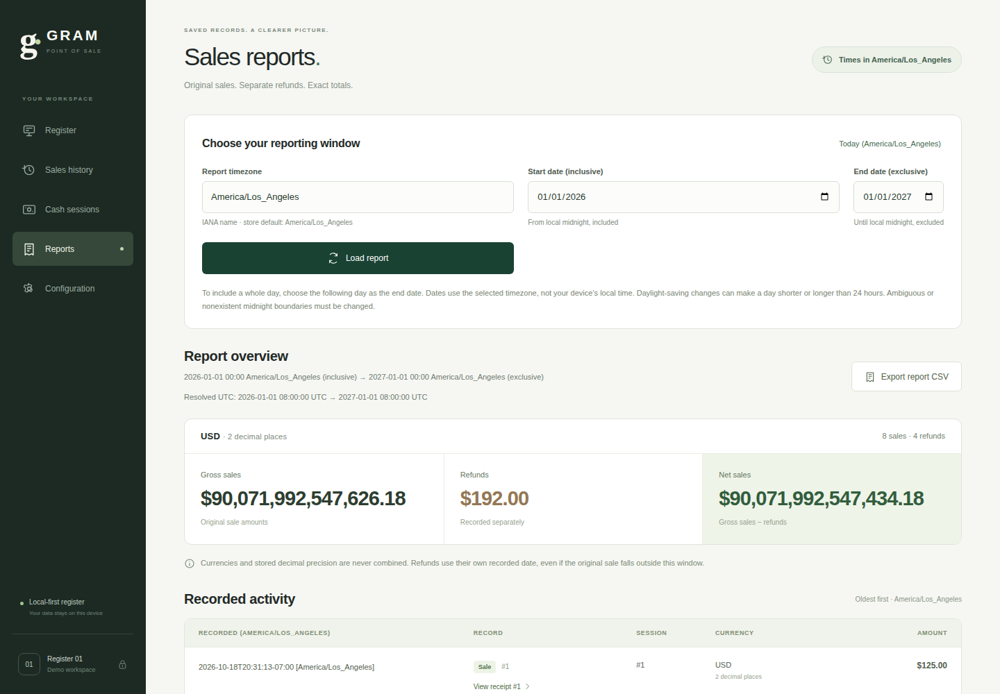

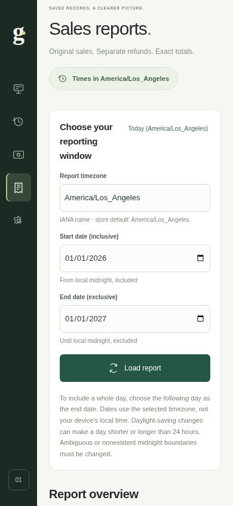

</details>

## Bulk catalog CSV (milestone 7)

Version 0.7.0 adds local, versioned catalog CSV export/templates and a read-only import preview before explicit atomic Apply. SKU is the stable upsert identity; missing products are never deleted. Errors identify rows, duplicate active/archived barcodes, missing price groups, and invalid exact amounts. Revision checks prevent overwriting newer edits. Spreadsheet-safe `text:` encoding is reversible, including leading-zero barcodes and legitimate apostrophes. See the [operator guide and complete CSV format](docs/catalog-csv.md).

These original captures come from the [passing real-browser job](https://github.com/LJrobinson/GRAM-POS/actions/runs/39187501879/job/117853222635) at commit `946979b`. All 16 browser scenarios passed against Rust and SQLite, including seven CSV scenarios. These are training fixtures, not real business data or a native file-dialog certification.

<details>
<summary>Review a valid mixed-product import before applying</summary>

Three new products and one update are staged, with saved/imported details side by side. No catalog changes have been saved in this capture.

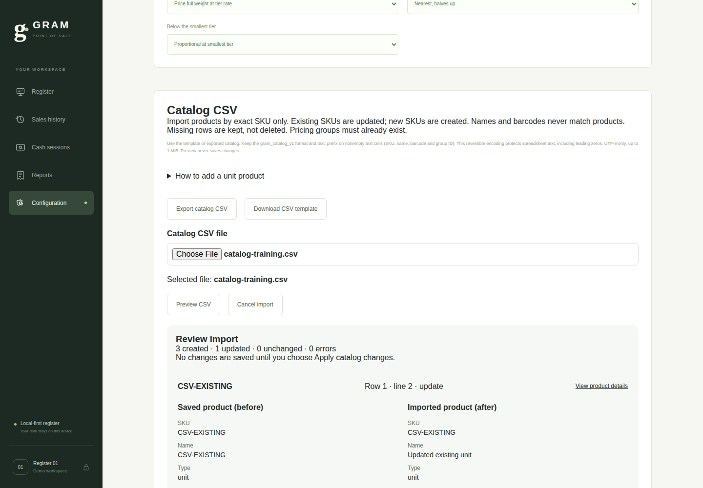

</details>

<details>
<summary>Inspect invalid prices and duplicate barcodes</summary>

Row and physical-line errors block Apply. The duplicate check includes archived products, and an invalid price cannot become a partial import.

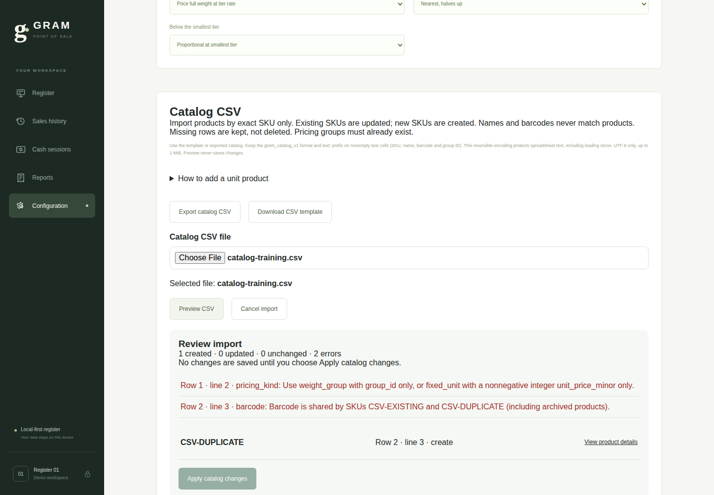

</details>

<details>
<summary>View the CSV review and errors on a phone</summary>

Review details and error text wrap within the narrow layout; further product fields and Apply remain accessible by vertical scrolling. The browser checks also apply the valid import at this viewport size.

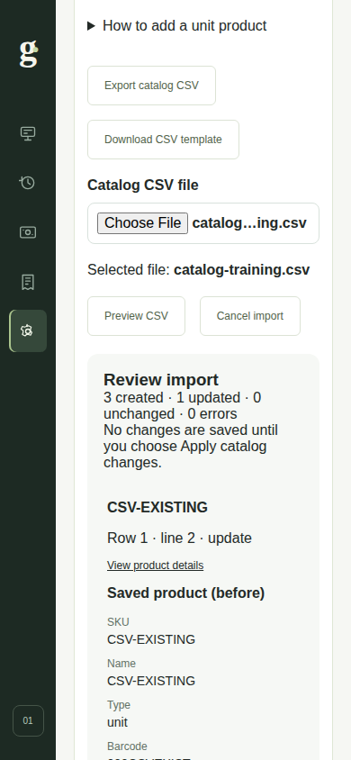

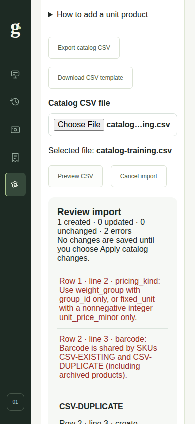

</details>

## See the prototype

The original register/catalog/cash-session screenshots below come from the [passing milestone-4 browser CI job](https://github.com/LJrobinson/GRAM-POS/actions/runs/39170235816/job/117801860359) at commit `53332e4`, using the local Rust service and SQLite test data. These show the **training/demo prototype**, not a production register or native-device certification.

### Register

Measured deli lines and whole prepackages in one cart, with Rust-computed pricing and separate recorded quantities.

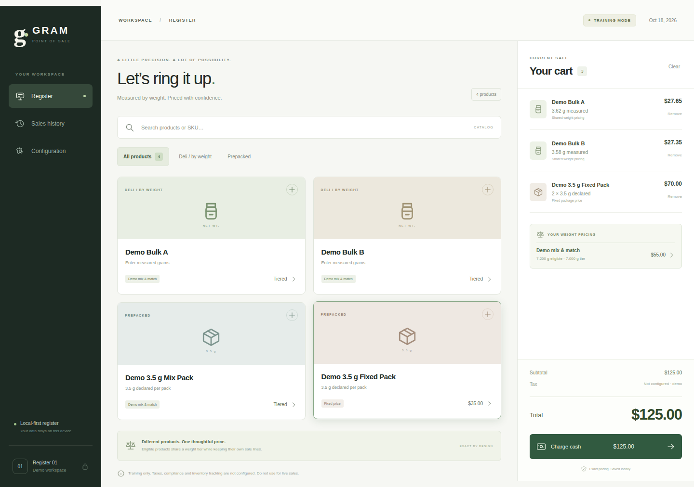

### Catalog and pricing

Create products, archive them, and configure shared pricing groups and explicit tier policies. Expand the full-page screenshot to inspect the editor.

<details>
<summary>View the full catalog and pricing editor</summary>

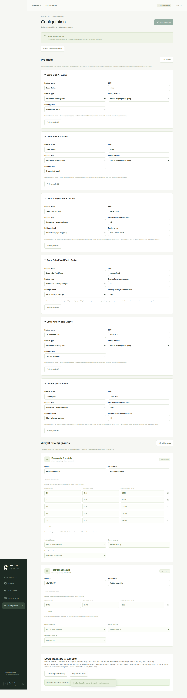

</details>

### Local backup and sales export

Download a consistent portable backup or a separate sales JSON report. Files are unencrypted; offline recovery creates a new database rather than replacing the live store.

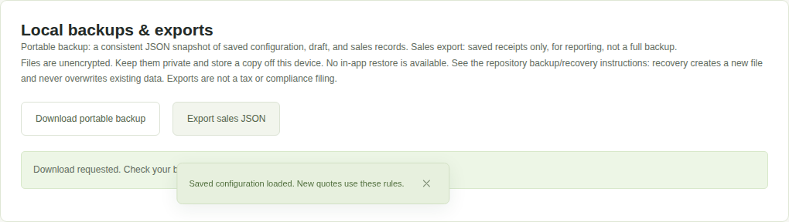

### Cash refunds and drawer reconciliation

Review the original full-sale refund with a reason, then compare counted cash with expected cash before permanently closing the drawer. No original receipt is rewritten and no stock return is inferred.

<details>
<summary>View full-receipt refund confirmation</summary>

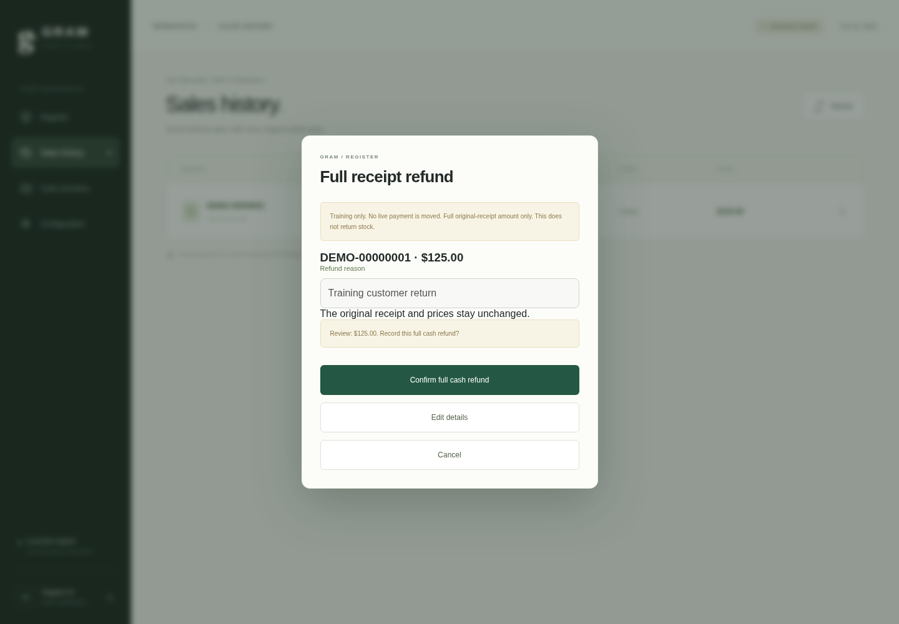

</details>

<details>
<summary>View cash-session closing count and variance</summary>

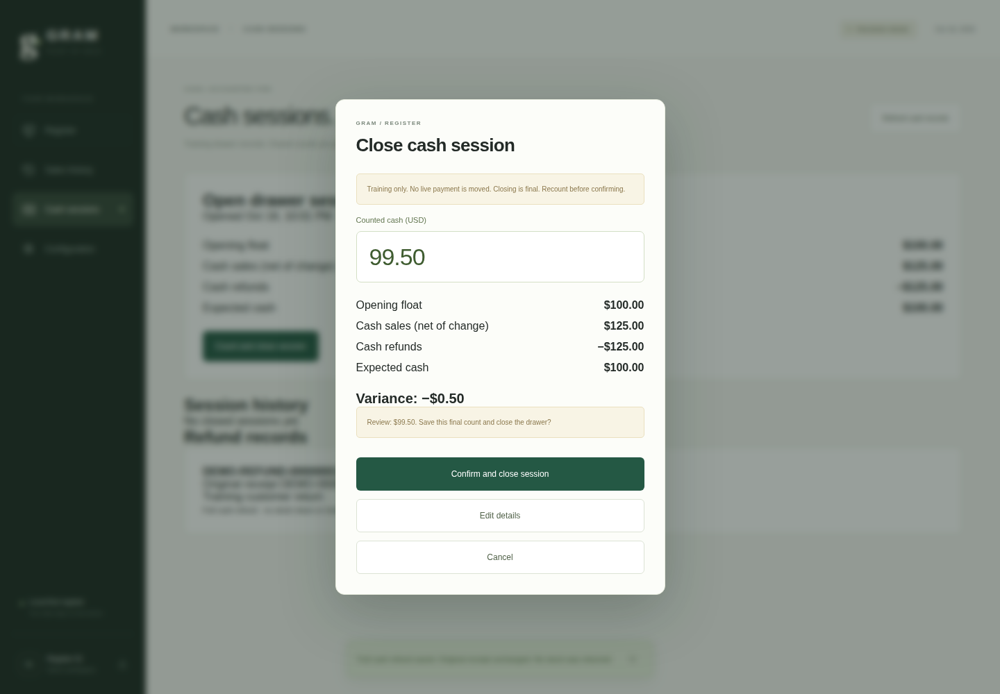

</details>

<details>
<summary>View mobile cash-session history</summary>

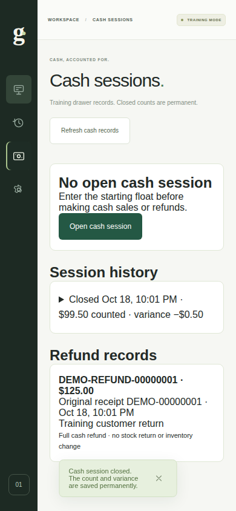

</details>

### Printable receipts and sales reports (milestone 5)

Original captures from the [passing milestone-5 real-browser job](https://github.com/LJrobinson/GRAM-POS/actions/runs/39177654986/job/117823723881), commit `5309fc2`. This run used the Rust service and SQLite, verified the print-only DOM, and generated the actual [sample receipt PDF](docs/screenshots/receipt-print.pdf). The PDF was rendered and visually inspected; it is not a physical-printer or native-device test.

<details>
<summary>View UTC sales, separate refunds and exact net totals</summary>

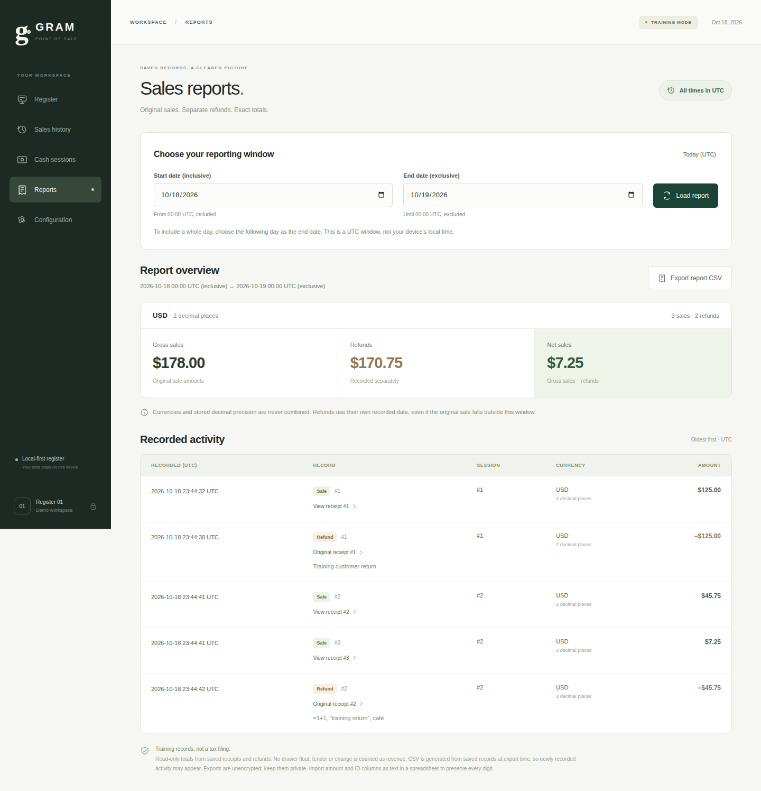

</details>

<details>
<summary>View the mobile reporting layout</summary>

The activity table scrolls horizontally; the summary remains readable without sideways page scrolling.

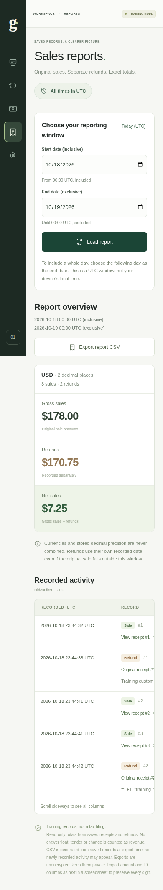

</details>

<details>
<summary>View the saved receipt preview and isolated print layout</summary>

The scrollable preview uses the original sale snapshot even after product edits and a full refund. Current refund information stays separate from the original printout.

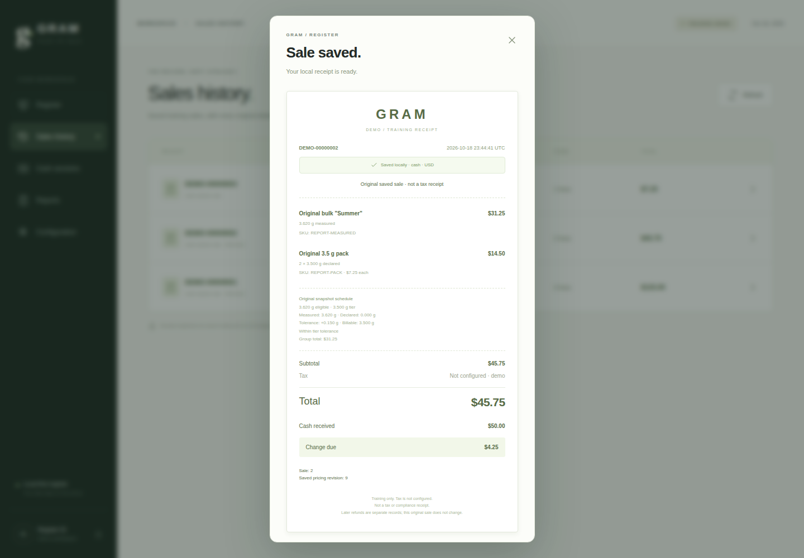

The print layout contains only the selected original receipt, not register controls or another sale. Paper and margins remain user-selected in the print dialog.

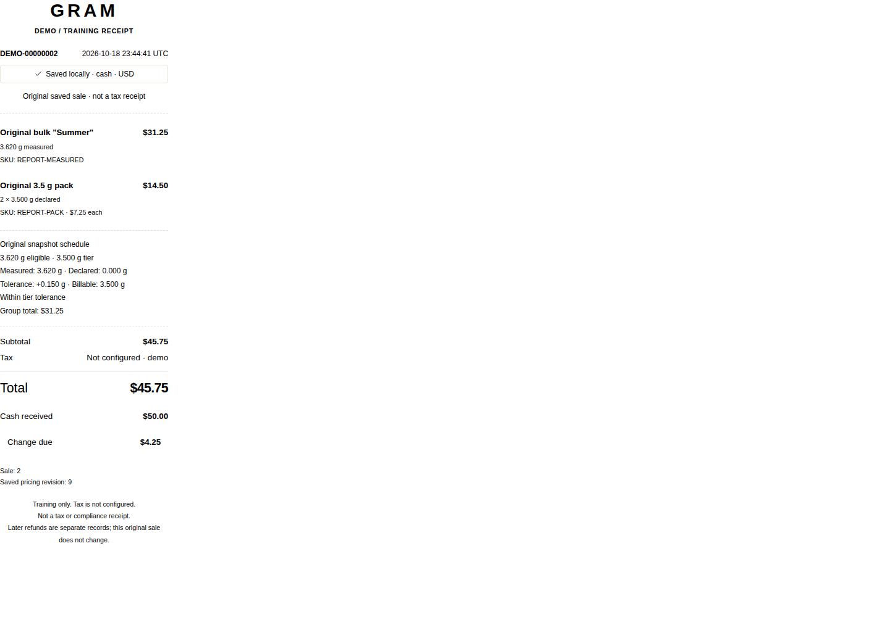

</details>

### Unit products and focused barcode scanning (milestone 6)

These original captures come from the [passing milestone-6 real-browser job](https://github.com/LJrobinson/GRAM-POS/actions/runs/39184353224/job/117843819615) for PR head `36b2428`. All nine scenarios passed using the real Rust service and SQLite, including delayed-scan cancellation and repeated scans. Training fixtures include intentionally extreme currency values from the exact-arithmetic tests; they are not real business records or hardware certification.

<details>
<summary>View two deliberate unit scans and their exact total</summary>

The focused barcode field added two separate one-unit lines at $4.25 each, totaling $8.50, without declared grams.

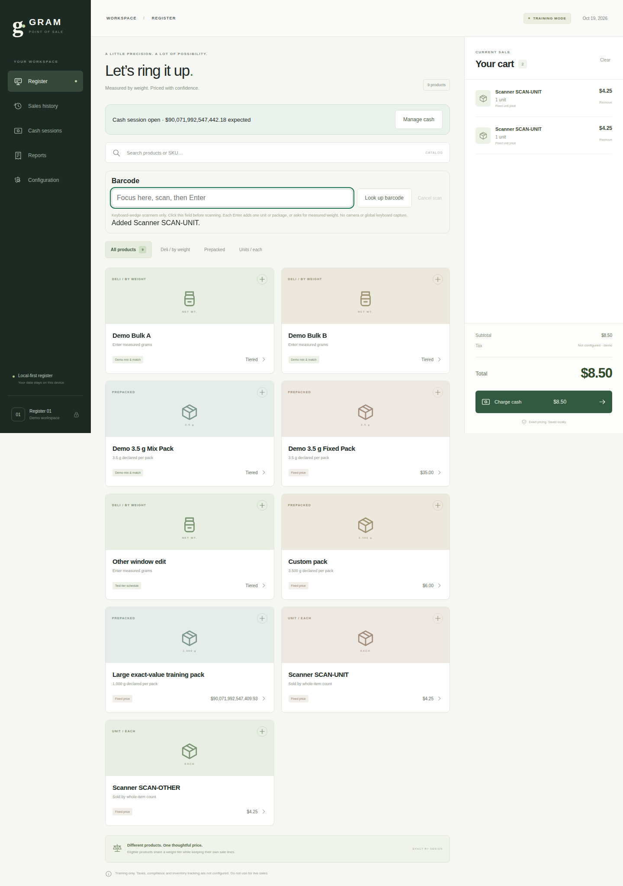

</details>

<details>
<summary>View the phone scanner and count-based cart</summary>

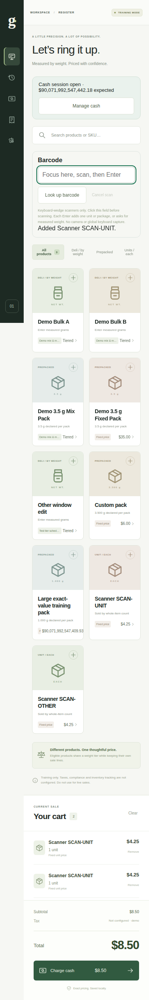

</details>

<details>
<summary>View the unit-product editor and exact barcode</summary>

A unit product has an exact barcode string and a price per item, with no declared gram content. These are original browser element captures, not reconstructed mockups.

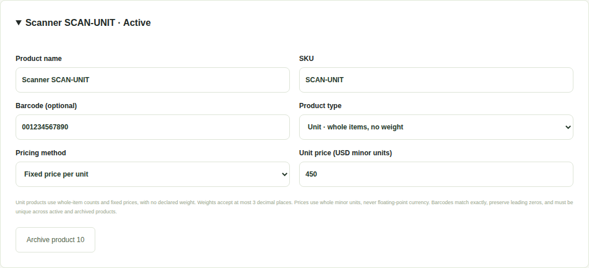

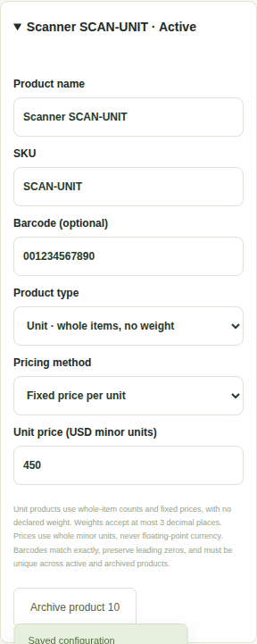

</details>

<details>
<summary>View an immutable count-based receipt on desktop and phone</summary>

Three units at $4.25 total $12.75, with $20.00 cash received and $7.25 change. The phone modal scrolls to its remaining refund/print controls. CI also verifies this original receipt remains unchanged after catalog edits and a full refund.

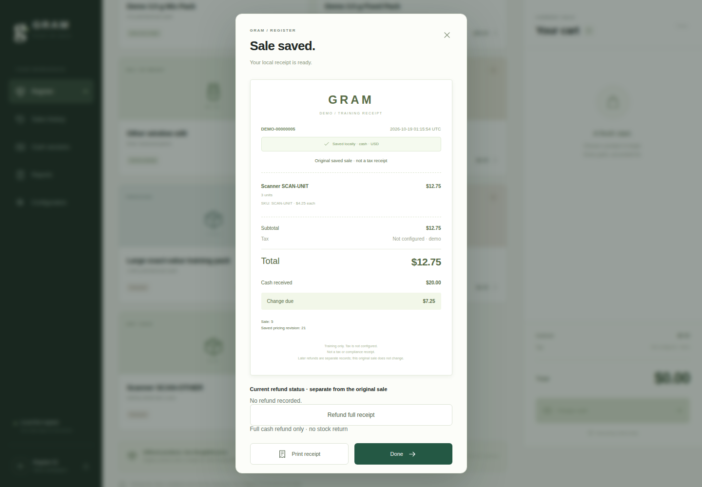

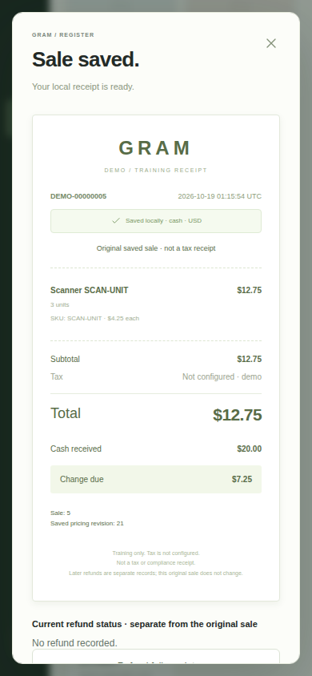

</details>

## Milestone 6: ordinary units and keyboard barcodes

Version **0.6.0** adds ordinary **Unit / each** products alongside measured goods and prepackages:

- Set a price per item and sell a positive whole-number count, with exact Rust money arithmetic. Unit products have no declared gram content and never join weight-pricing groups.
- Assign one optional barcode per product. Codes are exact, case-sensitive strings, so leading zeroes are preserved. A code remains reserved while its product is archived; duplicates are rejected rather than guessed.
- Focus the dedicated barcode field, scan with a keyboard-style HID scanner, or type the code and press Enter. Count products add one item; measured products open the weight-entry prompt. Unknown and archived codes report an error.
- Preserve the original quantity and price in saved receipts, refunds, reports and portable backups. Old measured/prepack records and older supported backups remain readable.

This is keyboard text entry, not a scanner driver: no camera, device permission, global key listener, inventory, stock adjustment or synchronization is added. See [unit products and barcodes](docs/units-and-barcodes.md) for validation, retry and compatibility details. Screenshots above retain their milestone labels; milestone-6 browser/native runtime evidence is tracked in [VALIDATION.md](VALIDATION.md).

## Milestone 5: printable receipts and date-filtered reports

Version **0.5.0** adds a focused, read-only view of the saved record:

- Print only the selected immutable receipt, including original product details, exact weights/pricing and currency. Current refund references are separate from the unchanged original sale.
- Report sales and refunds by their own event dates with explicit UTC start-inclusive/end-exclusive boundaries. Gross, refunds and net stay separate for every currency and precision; cash float/tender/change are not revenue.
- Export formula-defended UTF-8 CSV with exact minor-unit amounts, summary rows and event rows. CSV is a report, not a recovery backup.

See [receipts and reports](docs/receipts-and-reports.md) for dates, spreadsheet import guidance and printing limits. Printing opens a user-controlled dialog; no silent printing or printer drivers are added. Physical printers and native printing remain unverified. The milestone-5 captures above come from a passing real-browser run; earlier register/catalog/cash-session captures remain labeled milestone 4.

## Milestone 4: cash sessions and full-sale refunds

Version **0.4.0** adds a training-only cash ledger without rewriting any sale:

- Open a cash session with an explicit starting float before a new cash sale.
- Review expected cash as opening float plus recorded sales minus recorded refunds. Tender/change are not double-counted.
- Record a full-sale cash refund from the original receipt, with a required reason and the exact original total, even after catalog edits. Only one refund per sale is allowed. No stock return is inferred.
- Count the drawer, review the variance, then close the session permanently. Sales/refunds cannot be added to closed sessions. Historical refunds belong to the currently open session, not the original closed drawer.
- Preserve original receipts, session history, refund records, and retry identities through restart and portable backup/recovery.

Sessions snapshot currency and precision. Close the session before changing currency; refunds must match the active session's currency and precision. Old receipts without a session stay visible as legacy history and are never added to a new drawer's sales. Partial refunds, live payment refunds, inventory adjustments, user authentication, taxes, synchronization, and production/fiscal certification are not implemented. Cash paid-in/out records were added in milestone 10 above.

The service explicitly migrates recognized schema 1/2/3 stores to schema 4 while leaving their receipt/request bytes intact. The recovery tool accepts older v1/v2/v3 backups and v4 backups containing durable draft identity, parked carts, cash movements and recovery keys. Back up before upgrading; do not reopen an upgraded store with an older app. See [cash-session workflow](docs/cash-sessions.md) and [backup and recovery](docs/backup.md).

The earlier register/catalog/cash-session screenshots are original milestone-4 browser captures; the receipt/report section is labeled milestone 5. Current verification status is recorded in [VALIDATION.md](VALIDATION.md).

## Milestone 3: your catalog, local exports

The register remains a **prototype / demo only**, now with a user-managed catalog instead of a mandatory seed catalog:

- Start an empty register with an explicit currency, or deliberately load illustrative demo data.
- Create and edit measured products and prepackages, fixed package prices, and shared weight-pricing groups with editable tiers and explicit policies.
- Archive or unarchive products without changing completed receipts. Archived products cannot be quoted or sold; saved drafts remain visible for correction.
- Save the whole configuration atomically. Duplicate identifiers, invalid quantities/prices, missing groups, and malformed policies are rejected by Rust. A revision check prevents one window silently overwriting another's configuration.
- Download exact, versioned sales JSON and a consistent logical backup of the local store. The backup includes catalog, settings, draft, immutable sales/receipts, and retry keys. See [backup and recovery](docs/backup.md) for formats, privacy, and safe recovery to a new file.

Changing a product name, price, archive state, group, or currency affects future quotes only. Existing receipt snapshots stay unchanged. Empty catalogs are valid; they cannot complete a sale until products are configured. This milestone adds no inventory, tax, live payments, compliance, or device synchronization.

## Milestone 2: demo register

A touch-friendly React interface calls the same Rust pricing engine through a local register service. Native Tauri packaging stores SQLite data in the application's per-user data directory. Registers operate independently; no hosted backend or device synchronization is required for the native app.

- Explicitly load a demo catalog before use; settings and receipts remain marked **DEMO / no tax configured**.
- Ring measured deli selections and integer-count prepackages in one cart.
- See Rust-computed mix-and-match pricing without duplicating price logic in JavaScript.
- Record a **demo cash sale** with tender, change, immutable receipt/config snapshots, and an atomic SQLite commit.
- Recover a saved draft, reopen local sales history, and retry uncertain checkout requests using the same idempotency key.
- Adjust supported pricing tiers, allowances, and overage settings; stale quotes cannot silently finalize at a different amount.

This is **not production-ready dispensary software**, a card payment processor, tax/compliance engine, or inventory/ERP system. No real electronic payment is taken. Demo cash recording is for development and evaluation, not permission to conduct regulated sales.

### Run the actual register locally for development

The browser development adapter uses the real Rust service and a chosen SQLite file. It is loopback-only and is not a hosted production backend.

Terminal 1, repository root:
```sh
cargo run -p gram-register-service --features dev-server --bin register-dev-server -- --db ./gram-demo.sqlite3 --port 4174
```
Terminal 2:
```sh
cd apps/register
npm ci
npm run dev
```
Open the displayed loopback Vite URL. Choose an empty catalog and currency, or **Load demo register**. Use a separate demo database for experiments; do not point this prototype at another application's database.

### Windows native development build

See [native setup and packaging](apps/register/src-tauri/README.md). The included Register workflow tests the service and frontend, then builds an **unsigned Windows development installer**. A successful artifact build is not a real-device usability or peripheral test. iPhone/iPad packaging is not implemented in this milestone.

Local data and exported files are not encrypted by this prototype. Protect the device and keep a separate copy of backups. Use the snapshot export instead of copying an active SQLite file. Recovery is an explicit offline operation to a new file, not an in-app overwrite. Inventory and printer/scale drivers remain future work. Schema-1 stores migrate explicitly; incompatible future schemas are rejected. Never replace or delete a merchant's data file to resolve an error.

## Milestone 1: portable pricing core


## Run locally

Install Rust from https://rustup.rs/ (Rust 1.70 or newer) and open a terminal in this directory:

```sh
cargo test --all-targets
cargo test --doc
cargo run --example pricing_demo
cargo fmt --all -- --check
cargo clippy --all-targets -- -D warnings
```

The crate has no third-party dependencies. Test execution is local. A proposed GitHub Actions workflow is included for Windows, macOS, Linux, and a WebAssembly compile check; its presence is not evidence that those remote jobs ran.

## What this milestone models

- Exact weights in integer milligrams; exact currency amounts in integer minor units, with rational intermediate calculations.
- Measured deli quantities separate from prepacked unit counts and declared package contents.
- Configurable nominal weight tiers and one-sided overfill allowances, inclusive at the upper edge.
- Both explicitly selected merchant overage policies: full actual-weight charge at the selected tier's rate, or nominal tier price plus only the mass beyond its tolerance.
- Cart-wide mix-and-match through explicit common pricing groups, retaining original line quantities.
- Fixed-unit prepack pricing by default only when the caller explicitly selects it; weight promotion participation requires an explicit group assignment.
- Deterministic allocation of rounded group charges to lines, preserving the exact group total.
- Calculation explanations and configuration snapshots suitable for later receipt/audit integration.

## Merchant choices, not hidden defaults

Callers must explicitly supply the rounding policy, overage policy, tier allowances, below-minimum behavior, and supported tolerance scope. Demo prices and choices are test data, not recommended commercial settings. There is no automatically selected currency.

Tolerance is currently applied **once to the total eligible weight of a pricing group**, not once per visual cart row. This is an explicit prototype policy, not a claim that LJ has chosen it as the sole future workflow. It avoids multiplying allowances by splitting lines. Separate per-portion allowances require a deliberate future design with stable portion identities.

The implemented pricing schedule is a single selected tier rate, not a general promotion optimizer. It does not automatically compose bundles, stack discounts, choose the cheapest combination, or merge different price bands. Put different price bands into separate groups. When a larger tier is crossed, its configured rate is selected; merchant schedules can intentionally create price discontinuities. The configuration UI exposes these choices; test representative baskets after editing a schedule, especially near tier boundaries.

## Physical truth versus pricing

A deli quantity of 3.620 g stays 3.620 g even when a nominal 3.500 g price applies. Two packs declaring 3.500 g each remain **two packages with 7.000 g declared content**, not a claim of scale-measured mass. Configuring a retail size of 28.000 g does not redefine a physical ounce.

The API accepts explicit grams/milligrams; it does not silently convert the label “ounce” into a weight. Currency codes are syntax-checked, not validated against an online registry. Input precision beyond 1 mg is rejected rather than rounded. More general unit conversion and higher-precision adapters can be added without changing pricing semantics.

## Deliberately outside the pricing-core library (milestone 1)

The pure library does not implement UI, persistence, taxes, tender, refunds, inventory, devices, networking, customers, or compliance. Milestone 2 adds a separate demo UI/service with SQLite and cash-sale recording; all other production capabilities remain out of scope.

The intended application direction is independent Windows/tablet and Apple-device registers with local storage. This crate is isolated from those platform concerns. A successful WebAssembly compile does not provide browser storage, UI bindings, or hardware integration. Native iOS/iPadOS applications still require Apple tooling and platform testing.

## Project structure

- `src/`: reusable domain types, validation, pricing and allocation.
- `examples/pricing_demo.rs`: runnable concrete price calculations.
- `tests/`: independent acceptance and invariant tests.
- `docs/acceptance.md`: behavior coverage and design choices.
- `VALIDATION.md`: commands actually executed and their results.
- `PROVENANCE.md`: references, selected fixture adaptations, and pending license decision.
- `.github/workflows/rust.yml`: cross-platform core CI.
- `crates/register-service/`: local SQLite service and persistence tests.
- `apps/register/`: register frontend and native Tauri host.
- `.github/workflows/register.yml`: service/frontend checks and unsigned Windows development packaging.

## GitHub handoff

LJ selected the public GitHub repository `LJrobinson/GRAM-POS`. The license is still pending. The portable core and demo register are published; new milestones are reviewed through draft pull requests. Do not overwrite the existing UnitMath, CannabisMath, or MOBY repositories. The crate sets `publish = false`; a public package release is not part of this milestone.

Before publishing: choose a license and add complete notices, review the accepted commercial rules, and run the included CI on the intended platforms. See `PROVENANCE.md` for details. No license has been selected on the owner's behalf.
